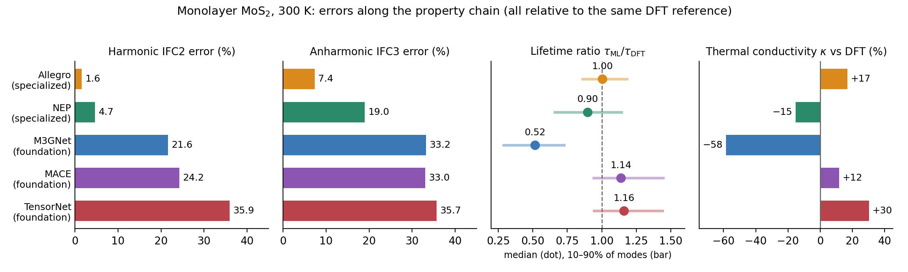
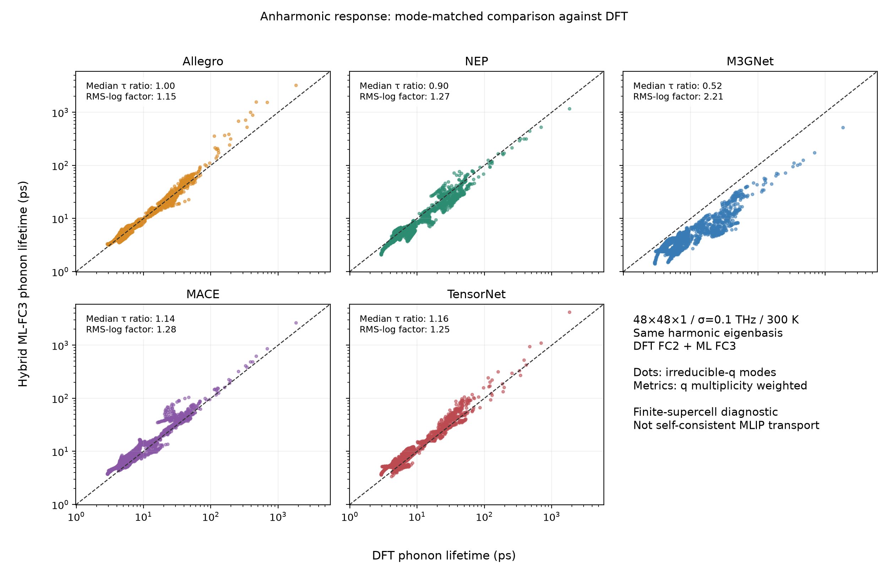
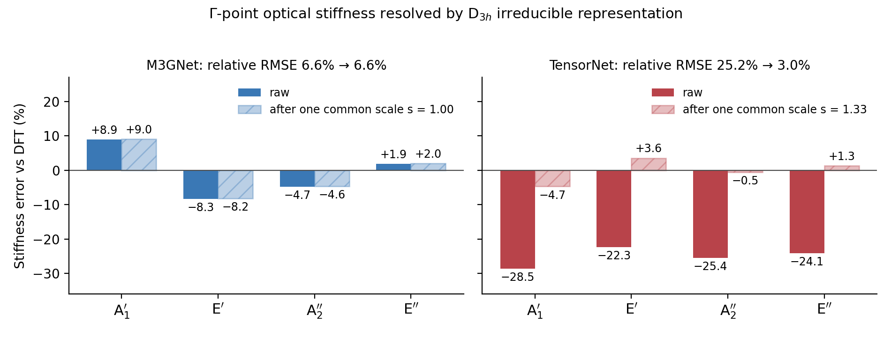

## Overview

Machine-learning foundation potentials are often judged by force or energy errors. Thermal transport, however, depends on a chain of derived quantities: harmonic force constants (IFC2), anharmonic force constants (IFC3), phonon lifetimes, and finally the lattice thermal conductivity \(\kappa\). This project asks a simple question: **does accuracy at one level of that chain carry over to the next?**

Five potentials were compared against the same DFT reference on monolayer MoS2:

- **Specialized potentials:** Allegro and NEP, which I trained during my PhD on PBEsol+D3 data for MoS2/WS2 nanotubes. Here they are used outside their training domain (a transfer test).
- **Foundation potentials:** M3GNet, MACE and TensorNet, all trained on MatPES-PBE (release 2025.2).

## Setup

- **Reference:** DFT (PBE), with finite-displacement force constants from 4×4×1 (IFC2) and 3×3×1 (IFC3) supercells.
- **Force constants:** each model's IFC2 and IFC3 are built at the same DFT equilibrium geometry with the same displacement sets and symmetry constraints, and compared with DFT using a relative Frobenius-norm error.
- **Lifetimes and \(\kappa\):** three-phonon relaxation-time approximation at 300 K on a 48×48×1 q-mesh. To isolate anharmonic errors, every calculation uses the **DFT IFC2 and only swaps in the model IFC3** ("hybrid" calculations). All models therefore share one harmonic eigenbasis, so 1950 irreducible phonon modes can be matched one-to-one with DFT without any mode assignment.
- **Symmetry diagnosis:** thirteen \(\Gamma\)-point optical displacements (±0.01 Å) are projected onto the \(D_{3h}\) irreducible representations, giving a stiffness error per symmetry channel.

## Key Results

*Errors relative to DFT at each level of the property chain. Lifetime ratios are the median over matched modes (weighted by q-point multiplicity); the bar spans the 10th–90th percentile of the mode distribution and is not a statistical error bar.*

| Model | IFC2 error | IFC3 error | Median \(\tau_{\rm ML}/\tau_{\rm DFT}\) | \(\kappa\) vs DFT |
|---|---:|---:|---:|---:|
| Allegro (specialized) | 1.6% | 7.4% | 1.00 | +17% |
| NEP (specialized) | 4.7% | 19% | 0.90 | −15% |
| M3GNet (foundation) | 22% | 33% | 0.52 | −58% |
| MACE (foundation) | 24% | 33% | 1.14 | +12% |
| TensorNet (foundation) | 36% | 36% | 1.16 | +30% |

- **Accuracy at one level does not guarantee the next.** M3GNet reproduces the DFT harmonic force constants better than MACE and TensorNet, yet it predicts phonon lifetimes that are about half the DFT values, and \(\kappa\) comes out 58% too low.
- **The IFC3 norm error is not the transport-relevant error.** M3GNet and MACE have almost identical IFC3 errors (33%), but very different lifetimes (0.52 vs 1.14 of DFT). A single tensor norm cannot tell which anharmonic couplings matter for heat transport.
- **Small tensor errors still leave a visible \(\kappa\) error.** Allegro is closest to DFT at every level, with a median lifetime ratio of 1.00, but its \(\kappa\) still differs by +17%. Among the foundation models, no single model is best on all metrics.

### Mode-Matched Phonon Lifetimes

*Each dot is one irreducible phonon mode, with DFT lifetime on the x-axis and model lifetime on the y-axis. M3GNet is shifted systematically below the diagonal across the whole lifetime range, whereas MACE and TensorNet lie close to it, slightly above on average.*

### Symmetry-Resolved Error Diagnosis

*Stiffness errors of the \(\Gamma\)-point optical modes, resolved by \(D_{3h}\) irreducible representation, before (solid) and after (hatched) applying one common stiffness scale factor \(s\) to each model.*

- **TensorNet** is about 25% too soft in all four symmetry channels. One common scale factor (\(s \approx 1.33\)) removes 98.6% of the squared relative stiffness error, which points to a global softening of the potential-energy surface, consistent with the softening reported for many foundation potentials.
- **M3GNet** has errors with different signs in different channels (A1′ +9%, E′ −8%). The best common scale is \(s \approx 1.00\) and changes nothing, so its error is symmetry-specific rather than global.

The two cases call for different fixes: a global softening can be addressed by rescaling or light fine-tuning, while a channel-specific error needs targeted training data for the affected displacement patterns.

## Outlook

- Use irrep-resolved errors to decide between global correction and targeted fine-tuning data.
- Extend the projector analysis from point groups to line groups for nanotubes, using [Pulgon-tools](../pulgon-project/).
- Repeat the property-chain benchmark after fine-tuning a foundation model, to test whether improvements at the force level propagate to lifetimes and \(\kappa\).

## Caveats

This is a diagnostic benchmark, not a final ranking of the models.

- One small system (monolayer MoS2) at one temperature (300 K).
- The DFT reference uses PBE with standard PAW datasets. It is not matched to the MatPES settings, and it differs from the PBEsol+D3 training data of Allegro and NEP.
- Force constants come from finite supercells. The DFT \(\kappa\) still changes by about 4% between 24×24×1 and 48×48×1 meshes, and by about 7% across the tested smearing widths.
- The \(\kappa\) values are hybrid (DFT IFC2 + model IFC3). They measure anharmonic accuracy only, not fully self-consistent model conductivities.
- The symmetry analysis uses thirteen displacements at a shared geometry. It is a diagnostic, not a corrected potential.
