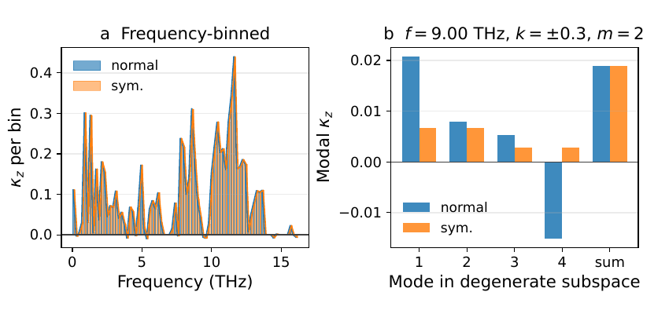
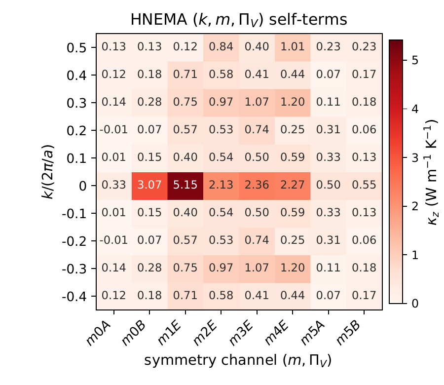
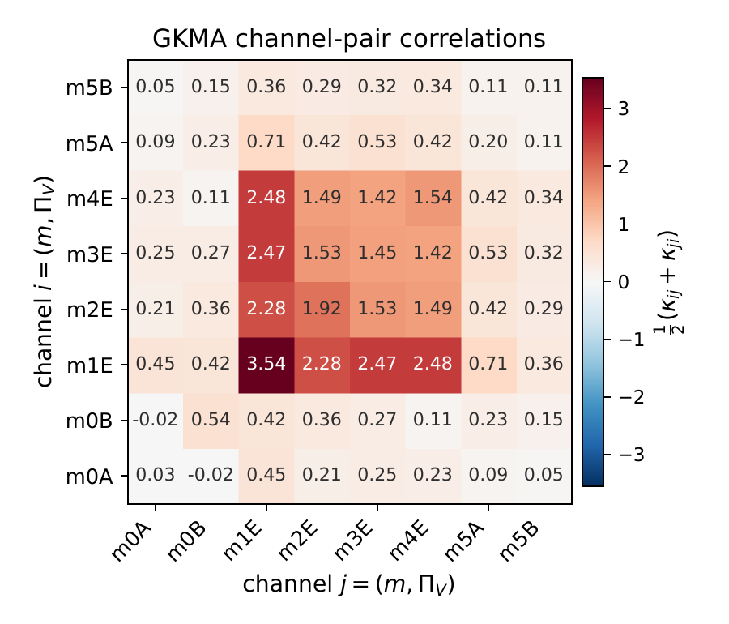
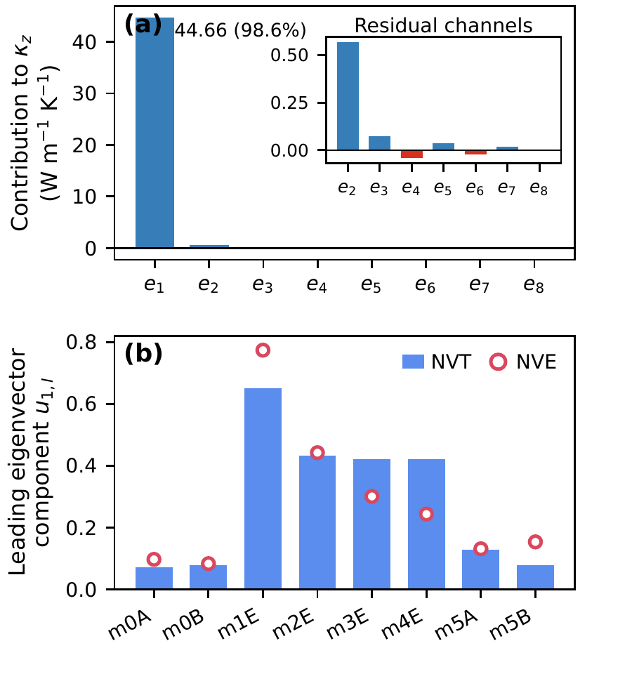

## Overview

Green-Kubo modal analysis (GKMA) and homogeneous nonequilibrium modal analysis (HNEMA) conventionally decompose heat transport using eigenvectors of the harmonic dynamical matrix. Within degenerate subspaces, however, those eigenvectors are only defined up to an arbitrary unitary rotation. Individual per-mode thermal conductivities can therefore depend on numerical details even though the total conductivity remains unchanged.

This work resolves that ambiguity for quasi-one-dimensional systems by constructing the modal basis from line-group projection operators. Every modal coordinate carries well-defined symmetry labels \((k, m, \Pi_V)\), making the decomposition unique at the level of irreducible representations.

*Normal and symmetry-adapted bases preserve the frequency-binned and degenerate-subspace sums, but redistribute the individual degenerate-mode contributions into a well-defined symmetry basis (Fig. 2 of the paper).*

## Method

- Identify the line group and its irreducible representations using Pulgon-tools.
- Build symmetry projectors for each folded axial wave vector \(k\) and irrep.
- Construct either a projector basis determined entirely by symmetry or a symmetrized eigenvector basis obtained by diagonalizing the dynamical matrix within each symmetry block.
- Use these bases in both GKMA and HNEMA to resolve thermal conductivity by line-group channel while preserving the total heat-current sum rule.

The framework was tested on a pristine \((10,0)\)-\((20,0)\) WS2-MoS2 double-walled nanotube using molecular-dynamics trajectories generated with a neuroevolution potential (NEP).

## Key Results

- The normal, symmetrized, and projector bases give the same total thermal conductivity, while the symmetry-adapted bases remove arbitrary mixing between degenerate modes.
- At 300 K, HNEMA gives \(44.6 \pm 15.5\) W m\(^{-1}\) K\(^{-1}\), while GKMA gives \(45.3 \pm 11.7\) W m\(^{-1}\) K\(^{-1}\), consistent within their seed-to-seed uncertainties.
- Heat transport is dominated by doubly degenerate E-type symmetry channels, with the largest contributions concentrated at low angular momentum \(m\) and near \(k=0\).
- The leading eigenvalue of the symmetry-resolved GKMA channel-pair matrix carries 99.1% of its Frobenius spectral weight. The large off-diagonal terms therefore form a collective, nearly rank-one transport pattern rather than many independent pair contributions.
- An independent NVE control reproduces the same E-type-dominated collective direction, showing that the structure is robust to removal of the production thermostat.

### Symmetry-Resolved HNEMA

*The \((k,m,\Pi_V)\)-resolved HNEMA map concentrates the largest conductivity contributions near \(k=0\) and in the low-\(m\), doubly degenerate E-type channels (Fig. 5).*

### GKMA Cross-Channel Correlations

*The symmetry-channel GKMA matrix exposes strong off-diagonal correlations between E-type channels, especially those involving \(m=1\) (Fig. 6).*

### Collective Eigenchannel

*One eigenchannel contributes 98.6% of the total conductivity and carries 99.1% of the matrix's Frobenius spectral weight. Its E-type-dominated direction is reproduced by the independent NVE control (Fig. 8).*

## Significance

The method provides a physically interpretable way to analyze finite-temperature heat transport in nanotubes and other quasi-1D materials. HNEMA offers an efficient irrep-resolved diagonal decomposition, while GKMA retains the full cross-channel correlation matrix. Together they expose symmetry-organized collective transport that is hidden by conventional mode-by-mode analysis.

[Download the full paper (PDF)](symmetry-adapted-gkma.pdf)
