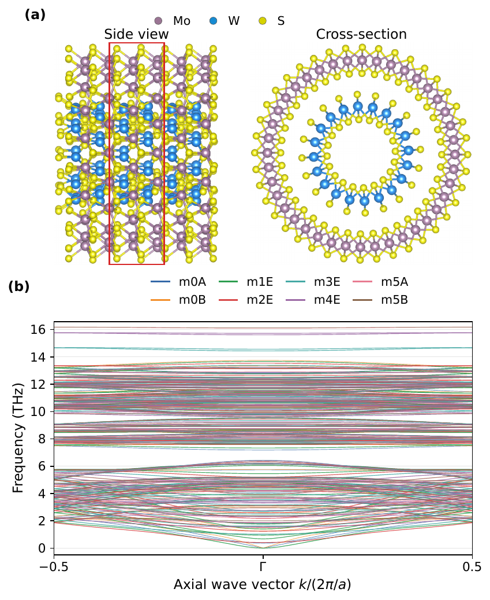
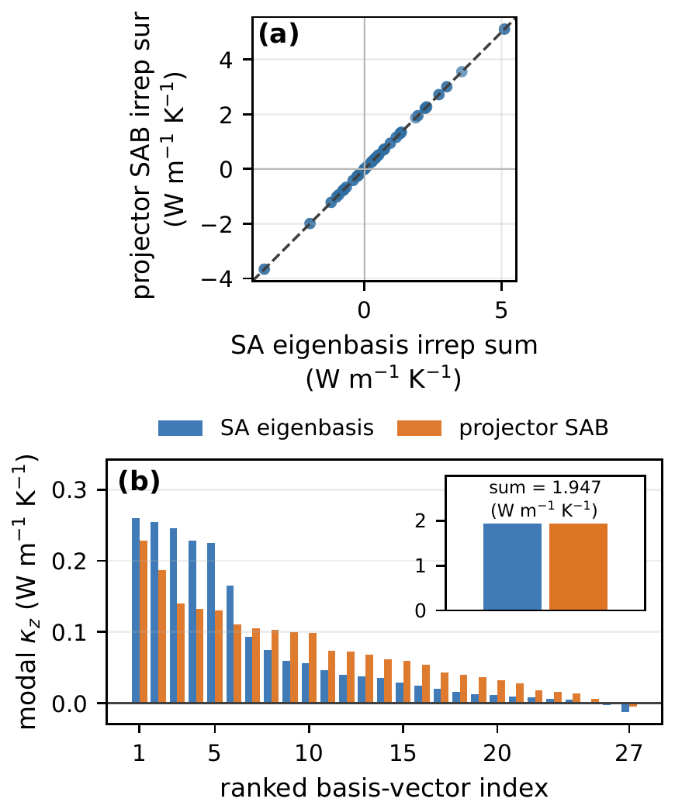
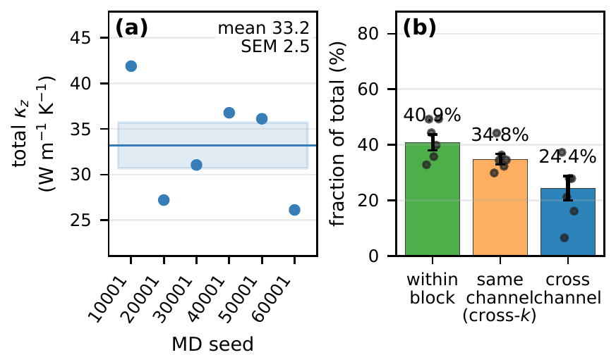

## Overview

Green-Kubo modal analysis (GKMA) and homogeneous nonequilibrium modal analysis (HNEMA) decompose the thermal conductivity obtained from molecular-dynamics (MD) trajectories by projecting atomic velocities onto the harmonic phonon eigenvectors. Within degenerate subspaces, however, those eigenvectors are only defined up to an arbitrary unitary rotation. Individual modal contributions are therefore basis dependent, and their symmetry character can be obscured, even though the total conductivity is unchanged.

This work resolves that ambiguity for quasi-one-dimensional systems by building the modal basis from line-group projection operators. Every projected component carries well-defined symmetry labels \((k, m, \Pi_V)\), and the decomposition becomes unique at the level of irreducible representations (irreps).

Paper: *Symmetry-based modal analysis of heat transport in molecular dynamics of quasi-1D systems*, [arXiv:2609.02397](https://arxiv.org/abs/2609.02397) (v2, September 2026).

## Method

- Identify the line group and its irrep characters with [Pulgon-tools](../pulgon-project/).
- Build a character projector for every commensurate axial wave vector \(k_n\) and irrep, and concatenate their column spaces into a **projector symmetry-adapted basis (SAB)**. It is determined by symmetry alone and needs no diagonalization of the dynamical matrix.
- Optionally diagonalize the dynamical matrix inside each \((k_n, \mu)\) block to obtain a **symmetry-adapted (SA) eigenbasis**, i.e. phonon modes that carry line-group labels.
- Supply either basis to the GKMA and HNEMA heat-current decompositions in GPUMD. Both bases are complete and orthonormal, so the modal heat currents still add up to the total.

## Application

- **System:** pristine \((10,0)\)-\((20,0)\) WS2-MoS2 double-walled nanotube, line group \(T'C_{10}\), 180 atoms per primitive cell.
- **Potential:** neuroevolution potential (NEP) trained on 920 PBEsol+D3 configurations (820 train / 100 test), with a test force RMSE of 54.7 meV/Å.
- **Simulation cell:** a \([1,1,10]\) supercell (1800 atoms), giving 10 axial wave vectors × 8 symmetry channels = 80 irrep blocks spanning 5400 modes.
- **Statistics:** HNEMA uses eight independent 100 ns NVT trajectories. GKMA uses six independent 100 ns NVE trajectories, averaged over a 0.30–0.70 ns correlation-time plateau.

*(a) Side and cross-sectional views of the double-walled nanotube. (b) Harmonic phonon spectrum colored by the eight line-group symmetry channels; m = 1–4 are doubly degenerate E-type channels (Fig. 1 of the paper).*

## Key Results

- **Basis invariance.** The conventional eigenbasis, the SA eigenbasis and the projector SAB give the same total conductivity. The two symmetry-adapted bases also give identical sums in every one of the 80 irrep blocks.
- **Consistent totals.** At 300 K, HNEMA gives \(33.5 \pm 3.6\) W m\(^{-1}\) K\(^{-1}\) and GKMA gives \(33.2 \pm 2.5\) W m\(^{-1}\) K\(^{-1}\), consistent within their seed-to-seed uncertainties.
- **Transport is spread over several symmetry channels.** The largest channels are m2E and m1E. The four E-type channels together carry 74.3% of the HNEMA conductivity, in line with their 80% share of the modes.
- **Nonzero wave vectors dominate.** In HNEMA, the \(k = \pm 0.1\) and \(k = \pm 0.4\) (in units of \(2\pi/a\)) rows carry the largest contributions, while the \(\Gamma\)-point row is statistically consistent with zero.
- **GKMA resolves the correlations.** Within-block terms account for 40.9% of the conductivity and same-channel cross-\(k\) terms for 34.8%, so 75.6% stays within one \((m, \Pi_V)\) channel. Cross-channel correlations contribute the remaining 24.4%.

### Basis Comparison

*(a) The frequency-resolved conductivity is unchanged by adapting the eigenbasis to the line-group symmetry. (b) In a zone-boundary doublet, the SA eigenbasis separates the two parities and redistributes 0.109 and 0.044 W m\(^{-1}\) K\(^{-1}\) into 0.076 and 0.076 W m\(^{-1}\) K\(^{-1}\), while the sum is unchanged (Fig. 2).*

*(a) All 80 irrep-block sums lie on the diagonal for the SA eigenbasis and the projector SAB. (b) Inside one 27-dimensional block, the individual contributions differ between the two bases, but the block sum (1.947 W m\(^{-1}\) K\(^{-1}\)) is identical (Fig. 3).*

### Symmetry-Resolved HNEMA

*HNEMA conductivity of the 80 \((k, m, \Pi_V)\) irrep blocks, with the \(k\)-summed channel totals in the bottom row. The largest contributions come from paired nonzero wave vectors rather than from the \(\Gamma\) point (Fig. 4).*

### GKMA Channel-Pair Matrix

*Symmetrized 8 × 8 GKMA conductivity matrix between \((m, \Pi_V)\) channels. The 80 × 80 irrep-block matrix is first summed over both wave-vector indices (Fig. 5).*

*(a) GKMA total for each of the six seeds. (b) Partition into within-block (40.9%), same-channel cross-\(k\) (34.8%) and cross-channel (24.4%) contributions; error bars are jackknife standard errors (Fig. 7).*

The prominent cross-\(k\) contributions mainly connect the momentum-conjugate sectors \(k_n\) and \(k_{10-n}\).

## Significance

The method gives a basis-invariant, symmetry-labeled decomposition of finite-temperature MD heat transport in nanotubes and other quasi-1D materials. HNEMA provides a statistically efficient single-index decomposition into channel contributions, while GKMA recovers the full irrep-block-pair matrix, including the cross-channel correlations that HNEMA cannot access. Because the projector SAB avoids constructing and diagonalizing the dynamical matrix, it is a promising route to larger systems.

[Download the full paper (PDF)](symmetry-adapted-gkma.pdf)
